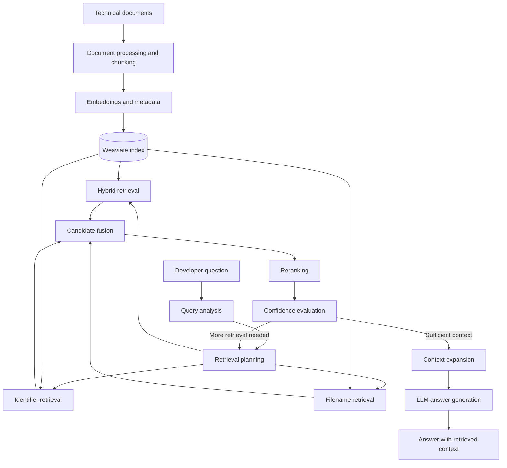

# Agentic RAG System for Code & Technical Documentation

**An intelligent retrieval system designed to help developers find relevant implementation details in technical books and documentation.**

This project explores how to build a more deliberate RAG pipeline: instead of relying on a single similarity search, it analyzes the query, plans retrieval, combines multiple search strategies, reranks candidate passages, and uses confidence signals to decide whether more retrieval is needed.

The goal is to return **relevant, traceable technical context** that an LLM can use to answer developer questions more precisely.

**Built with:** Python · Weaviate · Sentence Transformers · Flask · LangChain components

---

## Table of Contents

- [Overview](#overview)
- [Problem Statement](#problem-statement)
- [Key Features](#key-features)
- [Architecture](#architecture)
- [Retrieval Pipeline](#retrieval-pipeline)
- [Technology Stack](#technology-stack)
- [Evaluation and Benchmarking](#evaluation-and-benchmarking)
- [Project Structure](#project-structure)
- [Getting Started](#getting-started)
- [Current Limitations](#current-limitations)
- [Roadmap](#roadmap)

## Overview

Traditional RAG implementations often retrieve a fixed number of passages and immediately send them to an LLM. This approach can miss exact function names, retrieve conceptually related but irrelevant passages, or provide insufficient context for implementation-level questions.

This project investigates a more adaptive approach to retrieval.

The system is designed to work with technical knowledge sources such as programming books and documentation. Its initial knowledge base uses *Let's Go Further* by Alex Edwards, a book covering the development of a REST API in Go.

Example questions include:

- Where is the rate-limiting middleware implemented?
- How does the API validate query-string parameters?
- How does graceful shutdown work?
- Which implementation should I examine for a particular backend feature?

The emphasis is not simply on generating an answer. It is on finding the right technical evidence first.

## Problem Statement

Developer questions are frequently specific to an implementation. A useful system must distinguish between related concepts and the actual code, function, or section that answers the question.

For example, a question about input validation may retrieve generic references to JSON decoding instead of the relevant validation function.

The retrieval pipeline addresses this challenge through query analysis, multiple retrieval strategies, reranking, contextual expansion, and confidence-based retry decisions.

## Key Features

### Multi-strategy retrieval

The retrieval planner can use different search strategies, including:

- **Hybrid retrieval** — combines complementary retrieval signals.
- **Code-identifier retrieval** — targets implementation identifiers and code-related terminology.
- **Filename-based retrieval** — helps locate material associated with a known file or path.

The aim is to improve coverage for both conceptual questions and implementation-specific queries.

### Candidate fusion and reranking

Results from retrieval strategies are combined into a candidate set. A dedicated reranking stage then prioritizes passages according to their relevance to the query.

The project includes a local Flask-based reranking service using a BGE reranker model.

### Metadata-aware retrieval

Retrieved passages can carry useful source information, including chapter, page, section, content type, and code-related metadata where available.

This makes it easier to inspect why a passage was retrieved and identify where the relevant information originates.

### Context expansion

Relevant passages can be expanded with nearby context to preserve implementation details that might otherwise be lost when a document is split into chunks.

### Confidence-based retry decisions

The agentic pipeline evaluates retrieval signals and can decide whether another retrieval iteration is warranted.

Rather than always performing the same fixed sequence of searches, it uses confidence-related signals to guide further retrieval.

### Benchmarking and observability

The benchmark tooling records execution time, retrieval and generation timing, retrieved chunk counts, LLM calls, and evaluation outcomes.

This supports iterative investigation of retrieval quality and runtime cost.

## Architecture

The system can be understood as two connected workflows.

### 1. Knowledge ingestion

Technical documents are processed into searchable chunks, enriched with available metadata, embedded, and indexed in Weaviate.

### 2. Query processing

A user query is analyzed, a retrieval plan is selected, candidate passages are retrieved and reranked, relevant context is expanded when needed, and the resulting context is passed to the generation stage.



*The diagram represents the intended high-level pipeline. Exact module boundaries and optional stages depend on the active runtime configuration.*

## Retrieval Pipeline

The main engineering focus is the retrieval workflow.

1. **Analyze the query.** Identify the type of information the developer is requesting.
2. **Plan retrieval.** Select appropriate search strategies and parameters.
3. **Retrieve candidates.** Search the indexed knowledge base using complementary retrieval methods.
4. **Fuse candidates.** Combine results into a broader candidate set.
5. **Rerank results.** Apply a dedicated reranker to improve relevance ordering.
6. **Evaluate confidence.** Use retrieval signals to decide whether another iteration may improve the evidence.
7. **Expand context.** Include nearby passages when they are useful for understanding the implementation.
8. **Generate the answer.** Supply the selected technical context to the LLM.

The pipeline is designed to balance retrieval relevance, context completeness, latency, and model-call cost.

## Technology Stack

| Component | Technology | Responsibility |
|---|---|---|
| Application logic | Python | Retrieval orchestration and processing |
| Vector database | Weaviate | Document and embedding storage and search |
| Embeddings | Sentence Transformers ecosystem | Representing text for retrieval |
| Reranking | BGE reranker model | Relevance-based candidate ordering |
| Reranking service | Flask | Local HTTP interface for reranking-related operations |
| Document processing | PyMuPDF | PDF text extraction |
| LLM integration | LangChain components | Model integration and related pipeline components |
| Local infrastructure | Docker Compose | Supporting local services |
| Evaluation | Python benchmark tooling | Latency, call-count, and retrieval checks |

The actual model configuration, dependency versions, and runtime settings should be checked against the repository before reproducing the environment.

## Evaluation and Benchmarking

The project includes a benchmark harness with test queries covering:

- Rate-limiter middleware
- API pagination
- Graceful shutdown
- User-input validation
- CORS middleware

The benchmark can collect:

- Total query latency
- Retrieval latency
- Generation latency
- Number of retrieved chunks
- LLM invocation count
- Pass/fail outcomes for configured evaluation checks
- Pipeline-stage details for debugging

The benchmark supports comparing agentic, legacy, and non-agentic execution modes.

### Interpreting results

A successful keyword-based evaluation check is a useful smoke test, but it does not prove that the top-ranked passage is the best answer or that the generated response is factually correct.

A more complete evaluation should measure metrics such as Recall@K, MRR, and nDCG against a manually verified query-to-source dataset, alongside answer faithfulness and latency.

**Benchmark results:** Add a reproducible results table here after running the current benchmark on a clean, documented environment. Include the test dataset, configuration, number of runs, and hardware. Do not report unverified accuracy or performance improvements.

## Project Structure

The repository currently includes the following top-level components:

```text
RAG-system/
├── app/                 # Application and RAG pipeline
├── docs/                # Project documentation
├── docker-compose.yml   # Local supporting services
├── requirements.txt     # Python dependencies
└── README.md            # Project documentation
```

The internal module layout should be documented after verifying the current source tree.

## Getting Started

### Prerequisites

- Python version compatible with the project's dependencies
- Docker and Docker Compose
- Access to the LLM configuration required by the active generation implementation

### 1. Clone the repository

```bash
git clone https://github.com/alikhalil717/RAG-system.git
cd RAG-system
```

### 2. Create a virtual environment

```bash
python -m venv .venv
source .venv/bin/activate
```

On Windows, activate the environment with:

```powershell
.venv\Scripts\activate
```

### 3. Install dependencies

```bash
pip install -r requirements.txt
```

### 4. Configure environment variables

Create a local `.env` file using a documented `.env.example` template.

Add the required model credentials and service settings according to the actual application configuration. Never commit API keys, passwords, or other secrets.

### 5. Start the supporting services

Review `docker-compose.yml`, then start the services:

```bash
docker compose up -d
```

### 6. Run the application

Use the application entry point and commands documented in the current source code. The exact ingestion, startup, and query commands should be added here after verifying them against the repository.

> **Setup status:** The commands above provide the initial environment setup. Complete, reproducible run instructions require confirming the current entry point, required environment variables, indexing procedure, and model configuration.

## Current Limitations

- Retrieval quality depends on document parsing, chunking, metadata, and the quality of the indexed knowledge base.
- Confidence signals are heuristics and should not be treated as calibrated probabilities unless validated.
- Keyword-based benchmark checks are not a substitute for a ground-truth retrieval evaluation dataset.
- The local reranker and embedding services introduce compute and latency requirements.
- Performance and answer quality should be measured before making production-readiness claims.
- Setup instructions and supported configurations must remain synchronized with the codebase.

## Roadmap

- [ ] Document and test the complete clean-install workflow.
- [ ] Add an architecture diagram that reflects the exact implementation.
- [ ] Build a manually verified retrieval evaluation dataset.
- [ ] Report Recall@K, MRR, and nDCG across retrieval configurations.
- [ ] Compare agentic and non-agentic modes under reproducible conditions.
- [ ] Add representative examples showing retrieved sources and generated answers.
- [ ] Improve configuration validation, error handling, and operational documentation.
- [ ] Explore IDE integration and multi-repository knowledge retrieval.

---

## Author

**Ali Khalil**  
Backend Engineering · AI Systems · Retrieval-Augmented Generation

- GitHub: [@alikhalil717](https://github.com/alikhalil717)

---

*This is an evolving engineering project focused on retrieval quality, adaptive search, and evidence-grounded answers for developer workflows.*
